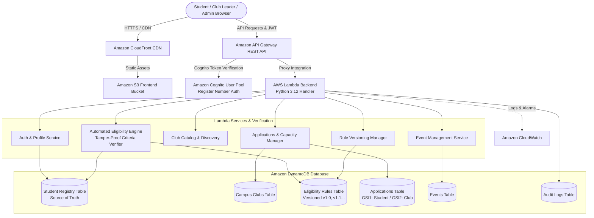

# Sathyabama Institute of Science and Technology (SIST)
## Campus Club Management Portal with Automated Student Eligibility Verification Using AWS Cloud

A production-ready, fully functional serverless web application engineered for **Sathyabama Institute of Science and Technology (Deemed to be University)**. Students authenticate using their official **College Register Number and Password**, create and set their own secure passwords, discover campus clubs, and undergo real-time **Automated Eligibility Verification** calculated strictly on AWS Lambda before submitting club membership applications.

The portal features the official **Sathyabama Institute of Science and Technology logo**, motto (*Justice • Peace • Revolution*), and dedicated role-based dashboards for **Students**, **Club Leaders**, and **Administrators**, backed by Amazon Cognito, API Gateway, AWS Lambda, Amazon DynamoDB, Amazon S3, and Amazon CloudFront.

---

## 🏛️ System Architecture



---

## ⚡ Key Features

### 1. Official College Register Number & Student Password Creation
- **Register Number as Username**: Students sign in using their **official university Register Number** (e.g. `123456789012`). Email is **never** required as the username.
- **Student Creates Their Own Password**:
  - The login interface features a tabbed workflow: **"Student Sign In"** and **"Create Your Password"**.
  - A student enters their official Register Number, which the backend verifies against the official university student database.
  - The student creates and confirms their chosen password.
  - The password is saved to Cognito / auth store and immediately allows the student to log in.
- **Pass-Through Security**: Plaintext passwords are **never** stored in DynamoDB. Amazon Cognito hashes and verifies passwords.
- **Official Sathyabama Logo**: Embedded on the login card, registration page, header, and navigation sidebar.
- **Role-Based Authorization**: Authorizes `STUDENT`, `CLUB_LEADER`, and `ADMINISTRATOR` accounts.

### 2. Automated Student Eligibility Verification Engine (Marquee Feature)
- **Zero-Trust Backend Calculation**: Eligibility decisions are computed strictly inside AWS Lambda. The backend never accepts student-supplied eligibility flags.
- **Criteria Evaluated in Real-Time**:
  - Minimum Cumulative GPA (e.g. $\ge 7.5 / 10.0$)
  - Minimum Aptitude Assessment Score (e.g. $\ge 70 / 100$)
  - Minimum Programming Assessment Score (e.g. $\ge 60 / 100$)
  - Department Restrictions (e.g. CSE, IT, ECE only)
  - Academic Year Restrictions (e.g. Year 2, 3, or 4)
  - Prerequisite Courses (e.g. Data Structures `CS201`, Basic Electronics `EC101`)
  - Required Certifications (e.g. AWS Certified Cloud Practitioner)
  - Minimum Class Attendance % (e.g. $\ge 75\%$)
  - Benchmark Skill Assessments (e.g. Robotics Basics `PASSED`)
- **Status Progression**:
  - `Eligible to Apply` (Green): Student satisfies all mandatory criteria; enables application submission.
  - `Not Eligible` (Red): Details the specific failure reasons and scores. Application button is locked.
  - `Pending Verification` (Amber): Official academic scores await registrar verification.
  - `Application Pending Approval` (Blue): Application submitted and awaiting leader review.
  - `Approved` (Emerald): Active club membership granted.
- **Rule Versioning**: When an administrator modifies criteria, a new version is created (e.g., `v1.0` $\rightarrow$ `v1.1`). Existing student applications preserve their evaluated rule snapshot to prevent retroactive invalidation.

### 3. Membership Applications & Capacity Enforcement
- DynamoDB conditional writes prevent duplicate applications from the same student for the same club.
- Club member counts are atomically incremented on approval.
- Applications and approvals are blocked when club capacity is reached.

### 4. Events Management
- Browse campus hackathons, workshops, and fests with real-time participant capacity meters.
- Duplicate registrations and post-deadline submissions are rejected on the server.

---

## 👥 Demo Personas & Pre-Configured Credentials

| Role | Name / Title | Register Number | Password | Profile Highlights |
| :--- | :--- | :--- | :--- | :--- |
| **Eligible Student** | Arjun Kumar | `123456789012` | `Student@123` | CGPA 8.2, Aptitude 75, Prog 80. Eligible for Coding, AI, Robotics Clubs. |
| **Ineligible Student** | Priya Sharma | `123456789013` | `Student@123` | CGPA 6.8, Aptitude 55 (<70), Prog 50 (<60). Fails Coding & AI Club requirements. |
| **Pending Verification** | Rahul Verma | `123456789014` | `Student@123` | Freshman record awaiting college registrar verification. |
| **Club Leader** | Priya Nair | `leader_coding` | `Leader@123` | Assigned Leader of Coding Club. Reviews applicants & creates events. |
| **Administrator** | Dr. Rajesh Murthy | `admin_portal` | `Admin@123` | Dean of Student Affairs. Configures rules, verifies records, exports reports. |

> **Quick-Fill Tip**: On the login screen, click any of the **Quick Demo Login Personas** buttons to fill credentials automatically.

---

## 💻 Local Quickstart (Zero External Dependencies)

The portal includes an emulation server that serves the frontend and routes `/api/*` requests through the AWS Lambda handler using Python's standard library:

```bash
# Start the local server
python server.py
```

Open your browser at:
**[http://localhost:8000](http://localhost:8000)**

---

## 🧪 Automated Test Suite

A complete test suite (`tests/test_suite.py`) verifies all 13 core requirements:

```bash
python -m unittest tests/test_suite.py
```

### Verified Test Scenarios:
1. Valid Register Number and Password allow login.
2. Invalid credentials and unactivated accounts are rejected.
3. Eligible student (Arjun) evaluates to `ELIGIBLE_TO_APPLY` and can submit applications.
4. Ineligible student (Priya) evaluates to `NOT_ELIGIBLE` with breakdown and cannot apply.
5. Missing verified information results in `PENDING_VERIFICATION`.
6. Students cannot tamper with official academic scores or registry records.
7. Duplicate applications are rejected.
8. Club leaders cannot access or review clubs assigned to other leaders.
9. Administrators can publish updated eligibility rules with version increments.
10. Historical eligibility results preserve original rule version snapshots.
11. Club capacity limits cannot be exceeded.
12. Duplicate event registrations are rejected.
13. Student privacy boundaries prevent viewing other students' private records.

---

## ☁️ AWS Cloud Deployment (AWS SAM)

### Prerequisites:
1. AWS CLI installed and configured (`aws configure`).
2. AWS SAM CLI installed (`sam --version`).
3. Python 3.12 or 3.11 installed.

### Step 1: Deploy with AWS SAM

```bash
# Build the application
sam build --template-file backend/template.yaml

# Deploy to AWS CloudFormation
sam deploy --guided
```

Or run the automated deployment script:
- **Windows**: `.\deploy.ps1 -StackName campus-club-portal -Region us-east-1`
- **Linux/macOS**: `./deploy.sh campus-club-portal us-east-1`

### Step 2: Upload Frontend to Amazon S3

```bash
# Retrieve frontend bucket name from stack outputs
BUCKET_NAME=$(aws cloudformation describe-stacks \
  --stack-name campus-club-portal \
  --query "Stacks[0].Outputs[?OutputKey=='FrontendS3Bucket'].OutputValue" \
  --output text)

# Sync frontend assets
aws s3 sync frontend/ "s3://${BUCKET_NAME}" --delete
```

### Step 3: Provision First Administrator

```bash
python backend/create_admin.py \
  --user-pool-id <COGNITO_USER_POOL_ID> \
  --client-id <COGNITO_CLIENT_ID> \
  --username admin_portal \
  --password "Admin@Secure2026" \
  --email "dean@campus.edu"
```

---

## 📊 DynamoDB Schema & Access Patterns

| Entity | Primary Key (PK) | Sort Key (SK) | Global Secondary Indexes (GSIs) | Access Patterns |
| :--- | :--- | :--- | :--- | :--- |
| **Student Registry** | `register_number` (String) | *None* | *None* | Get official academic record, verify student, source of truth. |
| **Clubs** | `club_id` (String) | *None* | `CategoryIndex` (PK: `category`) | List all clubs, filter by category, check member capacity. |
| **Eligibility Rules** | `club_id` (String) | `version` (String) | *None* | Get active rule (`v1.0`), retrieve rule history, publish new version. |
| **Applications** | `application_id` (String) | *None* | `StudentApplicationsIndex` (PK: `register_number`, SK: `club_id`)<br/>`ClubApplicationsIndex` (PK: `club_id`, SK: `status`) | Check duplicate application, list student applications, list pending club applications. |
| **Events** | `event_id` (String) | *None* | `ClubEventsIndex` (PK: `club_id`) | List active events, query event deadline & capacity. |
| **Audit Logs** | `actor_id` (String) | `timestamp` (String) | *None* | Retrieve compliance logs, track rule modifications. |

---

## 💰 AWS Cost Control & Optimization

1. **DynamoDB Pay-Per-Request (On-Demand)**: Tables are configured with `BillingMode: PAY_PER_REQUEST`, incurring zero cost when the portal is idle.
2. **Lambda Memory & Execution**: Configured for 256MB memory and ~40ms average cold start response time, fitting well within the monthly AWS Free Tier (1 million free requests/month).
3. **CloudFront CDN Caching**: Static frontend HTML/CSS/JS assets are cached at edge locations, minimizing S3 GET operations.
4. **CloudWatch Log Retention**: Log groups include 14-day expiration to prevent log storage accumulation.

### Deleting Resources After Testing:
```bash
# Delete CloudFormation stack and all cloud resources
sam delete --stack-name campus-club-portal

# Empty and delete frontend S3 bucket
aws s3 rb "s3://${BUCKET_NAME}" --force
```

---

## 🛡️ Security Best Practices
- **Least-Privilege IAM**: Each Lambda execution policy is scoped exclusively to required DynamoDB table ARNs and Cognito user pool actions.
- **Client-Side Non-Authoritative**: All eligibility outcomes, capacity limits, and score checks are calculated in Python on the server.
- **Input Validation**: Sanitizes and types all incoming parameters before storage or evaluation.
